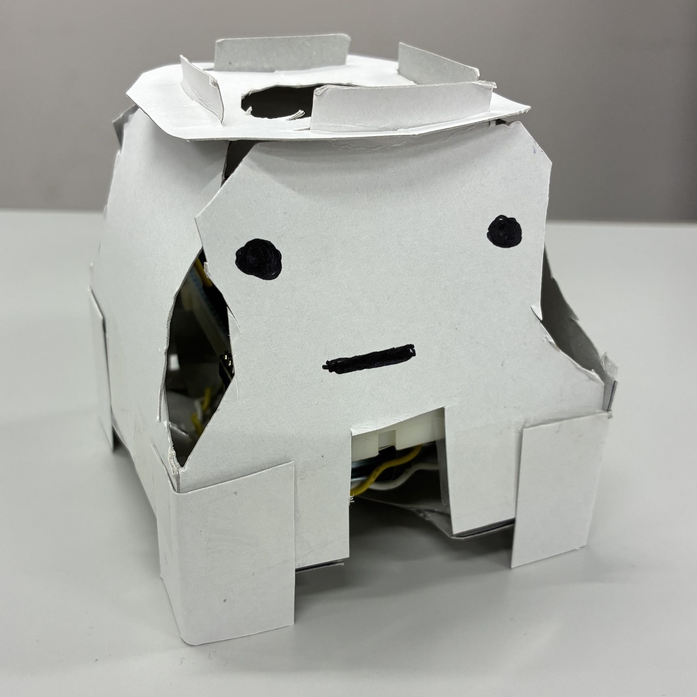
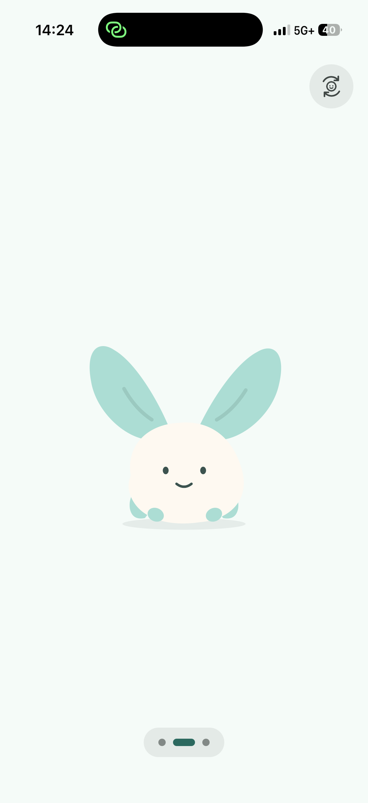
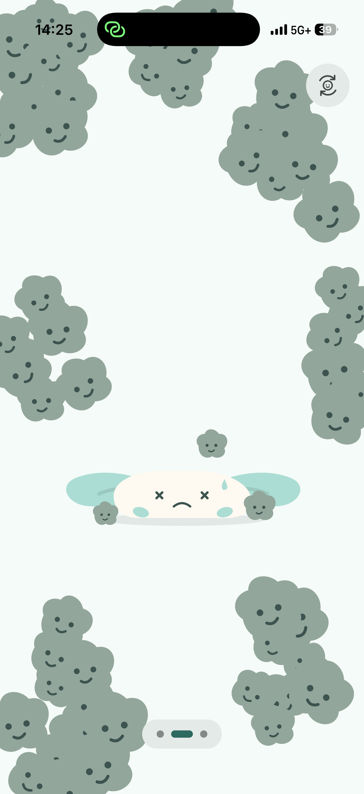
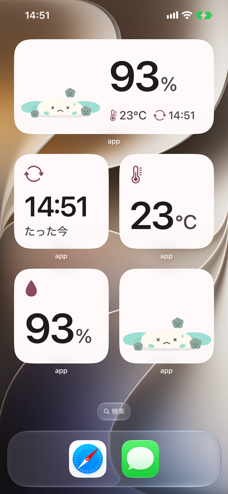

# カビのしらせ

[](https://youtube.com/shorts/o7meacB71Os)
https://youtube.com/shorts/o7meacB71Os

## 製品概要



部屋のカビは、気がつかないうちに生えてしまいがちです。我々はこの課題に対し、ユーザーの意識を自然とカビに向け、カビ予防行動を促すアプリ「カビのしらせ」を作りました。
部屋の湿度・温度からカビ指数を算出し、マスコットを用いて可愛く可視化することで、一目でカビの進行度を確認することができます。

### 背景（製品開発のきっかけ、課題等）

メンバーの1人が学生寮に入居した際、部屋に初めからカビがうっすら生えていました。その時はあまり気に留めていませんでしたが、しばらくするとカビが悪化してしまいました。
学生寮やアパートのような複数人が入居する環境では特に、自分だけではなく今後入居する人も快適に過ごせるように、カビ予防に対する意識を高めることが重要であると考え、本プロダクトを考案しました。

### 製品説明（具体的な製品の説明）

温湿度センサーを搭載したIoTデバイスを、カビの進行度を測定したい部屋に設置します。
アプリを起動すると測定データをデバイスから取得し、過去のデータと合わせてカビの進行度を推定します。カビが進行するほど、画面に表示されるキャラクターの元気が無くなっていくので、カビの生える危険性が一目で分かるようになっています。

| 危険度：低 | 危険度：中 | 危険度：高 |
| :---: | :---: | :---: |
|  |  |  |

### 特長

#### 1. 論文に裏打ちされた独自の数理モデル

科学論文で提唱されたカビの進行度を推定する数理モデルをベースに、独自に改変を加えたモデルで、目に見えないカビの進行度を推定します。

#### 2. 可愛いキャラクターによる可視化

アプリを開くと、可愛いオリジナルキャラクターが出迎えてくれます。現在のカビの進行度がキャラクターの元気具合に反映されており、一目で危険度を理解することができます。またウィジェットも用意されており、ホーム画面からキャラクターの状態を手軽に確認することも可能です。



#### 3. カビ予防のために取るべきアクションを提示

屋外と室内の湿度を比較して、「窓を開けよう」「外の方が湿っているから閉めよう」のようなアクションの提案を行います。可視化だけでなく、それに基づいたアクションまで結びつくように誘導します。

### 解決出来ること

「カビを生やしたくないけれど、普段は対策まで意識が向かない」という課題に対し、日常の中でカビ対策を意識するきっかけをつくり、予防行動につなげます。

### 今後の展望

- 大家さんへの提供を通じて、複数の部屋や物件への導入を広げます。
- 壁表面の温度・湿度を実測し、カビの進行度の推定精度を高めます。
- 現在は論文から引用しているモデルのパラメータを、壁の材質に応じて最適化します。

### 注力したこと（こだわり等）

- **直感的に使えるUI/UX**：ボタンを最小限に抑え、数字以外の文字を使わず、直感的な操作だけで使えるデザインにこだわりました。
- **換気の理由を可視化**：換気を促すだけでなく、なぜ換気が必要なのかもビジュアルでわかりやすく表現しました。
- **キャラクターで伝えるカビの危険度**：数値ではなく、キャラクターの元気・元気がない状態で表現し、部屋のカビの危険度が一目でわかるようにしました。
- **日常の中で意識するきっかけ**：ウィジェットでもキャラクターを見られるため、対策への意欲がまだ低い人でも、ふと目に留まることでカビ対策に意識を向けるきっかけをつくります。

## 開発技術
### 活用した技術
#### API・データ

* Open-Meteo API

#### フレームワーク・ライブラリ・モジュール

* React Native
* Expo

#### デバイス

* ESP32
* 温湿度センサー

### 独自技術
#### ハッカソンで開発した独自機能・技術

論文を元に独自の改良を加えた、カビの進行度を推定する数理モデルを作成しました。

窓や壁際など冷えやすい表面の湿度を、Magnus式（飽和水蒸気圧）で推定します。

```math
e_s(T) = 6.112 \exp\left(\frac{17.62\,T}{243.12 + T}\right), \qquad
RH_s = RH \cdot \frac{e_s(T)}{e_s(T_s)}, \qquad
T_s = T - \Delta T
```

これをVTTモデルに入れ、カビ指数$M$を1時間ごとに積分します。

```math
\frac{dM}{dt} = \frac{k_1 k_2}{7 \exp\left(-0.68 \ln T_s - 13.9 \ln RH_s + 66.02\right)}
```

* commit: [a1677c6](https://github.com/jphacks/tkb_2614/commit/a1677c68657ecc2ef9d2171393964e1b49d1df19), [38670d5](https://github.com/jphacks/tkb_2614/commit/38670d5d8e7c0c28340533c5875e9e2beb71fe8d)
* 参考にした論文: Ojanen et al. (2010), [Mold Growth Modeling of Building Structures Using Sensitivity Classes of Materials](https://web.ornl.gov/sci/buildings/conf-archive/2010%20B11%20papers/104_Ojanen.pdf)
