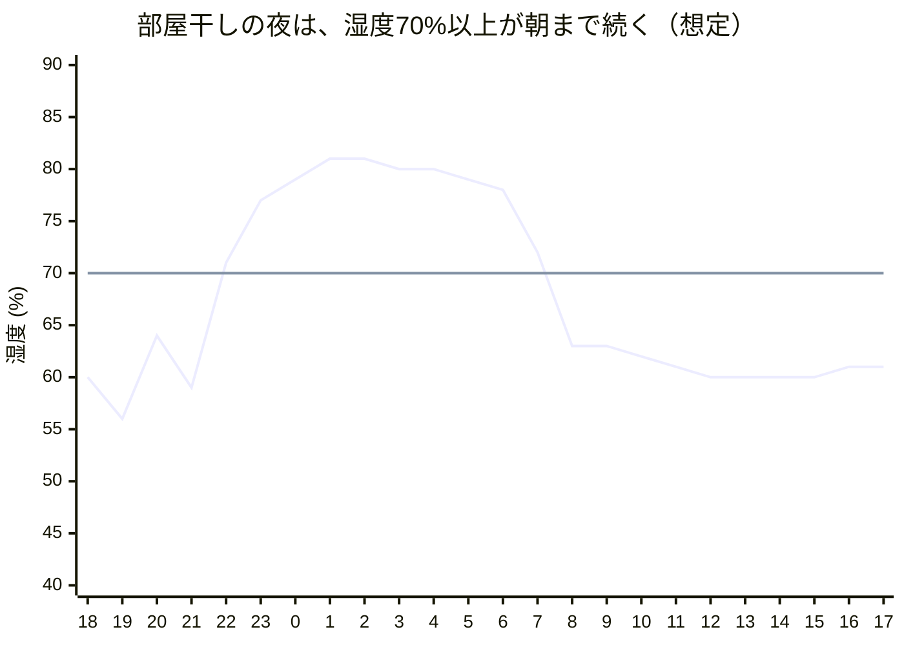

# ペルソナとアプローチ検討

## このドキュメントの使い方

このドキュメントは、人が決める場面で使う材料である。PR やコード変更のたびに照らし合わせるものではない。

- **使う場面**：機能の優先順位を決めるとき、デモの流れを決めるとき、発表資料を作るとき。
- **今ある機能は否定しない**：ペルソナを決める前に作り始めたので、今ある機能はペルソナ B のどの場面で役立つかに当てはめ、デモや発表でどの順に見せるかを決めるのに使う。
- **いつも守るのは「表現で避けること」だけ**：アプリの文言を直すだけで済むためである。

## 結論

メインのペルソナは B（一度カビが生えて困った、一人暮らしの賃貸住まいの人）にする。A（関心が薄い層）と C（強い危機感がある層）は、**新しく足す機能や見せ方を決めるときの補助**として使う。

- 方向性：エアコンで部屋の空気を自動で整える既存サービスとは戦わない。「自分の家のどこで、どんな行動が足りていないのか」が分かり、自分で直せることを価値にする。
- 実体験から分かったこと：カビは部屋の空気が湿っているから生えるのではなかった。**水の残る場所（風呂場、水漏れ）と、手入れの習慣が途切れたこと**が原因だった。そのため、センサーで「湿気が出た瞬間」を捉え、その場ですべき習慣を促す方向に寄せる。
- キャラ：入口として使い、続けてもらうための手段にとどめる。投資の配分は「原因の特定と行動提案 6：キャラと UI 4」を目安にする。

## 競合との比較と新規性

既存の自動制御（SwitchBot、Nature Remo など）は、部屋の空気を瞬間値で制御する。こちらは、水が出る場所とその時間の経過を見て、人の行動に結びつける。

| 観点 | 既存の自動制御 | このプロダクト |
| --- | --- | --- |
| 見る場所 | 部屋の中央付近の空気 | 風呂場、押し入れ、窓際など、水が出る場所や結露する場所 |
| 見る指標 | その瞬間の湿度 | 高湿度が何時間続いたか、入浴後どれだけ早く下がったか |
| 出力 | 家電の ON/OFF | 原因の説明と、その場ですべき行動（水切り、換気、定期の手入れ） |
| 導入コスト | ハブと対応家電が必要 | センサー1個とスマホ |
| スマホがないとき | — | ESP32 の LittleFS に記録し、あとから吸い上げる（実装済み） |

部屋の場所による差は、すでに検討した。

## ペルソナ

B に合わせて機能を設計し、A と C は「この機能を入れると誰が離れるか」を確かめるときに使う。

| | B（メイン） | A（補助） | C（補助） |
| --- | --- | --- | --- |
| 人物像 | 社会人1〜2年目、一人暮らし、賃貸 1K | 大学2年、一人暮らし、ワンルーム | 子育て世帯、またはアレルギー・喘息がある人 |
| カビへの意識 | 風呂場や天井にカビが生えてショックを受けた。何が悪いのかは分からない | 生えたら拭けばいいと思っている | 健康リスクとして本気で気にしている。除湿機などをすでに持っている |
| 今やっている対策 | カビキラーで一時的に対処。防水テープの貼り直しは面倒でやっていない | ほぼ何もしていない | 除湿機や定期的な掃除をしている |
| 欲しいもの | 自分の家で、どこで何をすればいいかが1行で分かること。効いたかどうかが分かること | 手間ゼロの楽しさ。敷金が戻ること | 正確さと安心 |
| このペルソナの役割 | 機能を決める基準 | 手間と継続のハードルを測る | 正確さと信頼性のハードルを測る |

## 実体験のヒアリング（ペルソナ B の一例）

カビが生えたのは、天井の水漏れ部分と、風呂場のプラスチック製シャンプー棚や隅（ピンク色の汚れ）。どちらも部屋の空気ではなく、**水が残る場所**で起きている。

| 場所 | 考えられる原因 | そのときの対策 | センサーで分かるか | アプリでできること |
| --- | --- | --- | --- | --- |
| 天井 | 水漏れ | — | 直接は分からない | 入浴などがないのに高湿度が続くとき、「水漏れを確認して管理会社に連絡しては」と伝える程度 |
| 風呂場 | 換気扇だけでは足りなかったか？（分からない） | — | **分かる**。入浴後に湿度が下がるまでの時間を測れば、換気が足りているか判定できる | 「乾くまで 3 時間かかっている。窓も開けて」のように結果を見せる |
| 風呂場 | 水切りできる場所を水切りしていない | — | 入浴のタイミングは分かる | 入浴を検知したら「今、水切り」と通知する |
| 風呂場 | カビキラーや燻煙剤を定期的に使っていない | カビキラー | いいえ | 定期的な手入れをリマインドする。積算リスクが高い月は前倒しする |
| 風呂場 | 入居時に防水マスキングテープを貼っていない。または貼ったが更新していない | 面倒で貼り直していない | いいえ | 引っ越し直後のチェックリストと、貼り替え時期の通知 |

### 分かったこと

- 「換気扇だけで足りたのか分からない」という疑問に、センサーがそのまま答えられる。入浴後に湿度が下がるまでの時間が、ペルソナ B に一番刺さる指標になりそう。
- 原因の多くは「分かっているのにやっていない」習慣（水切り、定期的な手入れ、テープの貼り替え）だった。知識よりも、**タイミングよく促すことと、手間を減らすこと**が価値になる。
- センサーで分かるもの（入浴、換気の効果）と、分からないもの（定期的な手入れ、水漏れ）を分けて設計する。分からないものはカレンダー型のリマインドで補う。
- 水漏れのような建物の問題は、置き場所が合っていなければ検知できない。扱うのは「異常に気づかせる」ところまでにする。
- 未確認：ESP32 と Si7021 を浴室に置けるか。防水ケースや、結露したときのセンサーの値を確かめる必要がある。

## 部屋での想定シミュレーション

1K（洋室7畳、約28m³）は、空気が持てる水分がとても少ない。室温20℃で湿度50%から70%に上げるのに必要な水は、**約100g（コップ半分）**だけである。そのため、部屋干しや1晩寝ただけでも、換気しなければすぐに高湿度になる。

数値はすべて計算上の目安で、実測ではない。実際には換気や壁・家具が吸う分だけ上昇は小さくなる。カビの目安は一般的なもの（湿度70%以上で生えやすく、80%以上で急に増える）を使った。

| シナリオ | 湿気の出どころ（目安） | 部屋の中央のセンサーの見え方 | センサーだけでは気づけないこと | 提案する行動 |
| --- | --- | --- | --- | --- |
| S1 冬の夜の窓の結露 | 室温20℃、湿度55%。外気2℃で、一枚ガラスの表面は8℃前後になる | 55%で問題ないように見える | 露点は約11℃で、窓はそれより冷たいので結露する。窓表面が8℃なら、室内は48%以下でないと結露する | 寝る前に湿度を下げる。カーテンを窓から離す。朝、結露を拭く |
| S2 夜に部屋干し（窓は閉めたまま） | 洗濯1回分で数リットルが数時間かけて出る | 急に上がって、75〜80%台が朝まで続く | 原因が部屋干しかどうか。時刻から推定し、ワンタップで確認する | 除湿機かエアコンの除湿。サーキュレーターを当てる。浴室乾燥を使う |
| S3 就寝中に閉め切る | 人の呼吸と汗で1晩数百g。夜は室温が下がるので、湿度はさらに上がる | ゆるやかに上がる | 布団の下や床面の湿気 | 朝に5〜10分換気する。布団を上げる |
| S4 梅雨・夏に閉め切って外出 | 外気自体が湿度80%前後 | 70%以上が日中ずっと続く。スマホは家にないが、ESP32 の記録からあとで分かる | — | 外出中に除湿をタイマーで入れる。帰宅後すぐに換気する |
| S5 冬に加湿器をつけっぱなし | 室温20℃で湿度65% | 65%で「少し高い」程度に見える | 露点が約13℃まで上がり、窓や北側の壁が結露する | 加湿器の設定を40〜50%にする |

### 分かったこと

- **部屋の中央の値だけを見ていると、冬のカビ（S1、S5）を見逃す**。部屋は55〜65%でも、窓や外壁側の壁は結露している。室温と湿度から露点を出し、「窓が○℃を下回ると結露する」と言えれば、既存の自動制御にはない「結露予報」になる。
  - 窓の表面温度は、スマホから天気予報の外気温を取って推定するか、窓際にもう1台置く。どちらも自前のサーバーはいらない。
  - 冷たい表面の湿度の推定は、[mold-model.md](mold-model.md) の ΔT と同じ考え方で扱える。
- **湿度の上がり方で、原因の候補を絞れる**。急に上がるなら部屋干し・料理・入浴（S2）、ゆるやかに上がって続くなら就寝や閉め切り（S3、S4）。これなら、毎回の手入力をさせずに済む。
- **指標は「1日のうち湿度70%以上だった時間」にする**。瞬間値よりカビの育ち方に近く、キャラを育てる量にもそのまま使える。
- **競合と重なるのは S4 だけ**。自動制御が一番効くのはここなので、こちらは「留守中にこうなっていた」と気づかせるところまでにする。
- 未確認：窓際と部屋の中央の差は、既存の検討結果の数値と合わせて確かめる。

### ペルソナ B の平日1日（シミュレーション）

仮定値によるシミュレーション（実測ではない）。冬の平日、1K（約28m³）、暖房中の室温は20℃前後。部屋の中央の湿度。

出来事：19時 帰宅・暖房、20時 料理、22時 入浴、23時 部屋干し、0時 就寝、7時 起床・暖房、8時 外出。70%以上だった時間は 24 時間中 10 時間（2本目の線が 70% の目安）。

70%を超えるのは、入浴と部屋干しが重なった夜から朝まで。日中の留守のあいだは60%前後で落ち着いている。そのため、行動を促すタイミングは**22〜23時の1回**で足りる（「部屋干しするなら除湿をつけて寝る」）。朝は、記録を見せて結果を伝えるだけにする。

## 表現で避けること

アプリの文言、通知、発表資料ではいつも避ける。文言を直すだけで済む。

| 避ける表現 | 判断したペルソナ | 代わりの表現 |
| --- | --- | --- |
| 健康被害の可能性や、医療的な効果をうたう | C | 根拠を示せず、言いすぎると信頼を失う。「カビが生えやすい条件に近づいている」までにする |
| 「ここにカビが生えている」と断定する | C | 温湿度だけでは分からない。「生えやすい状態が続いている」にする |
| 水漏れなど建物の問題があると言い切る | C・B | 検知できる範囲を超える。「いつもと違う湿気が続いている」と気づかせるところまでにする |

## これから足す機能で避けること

新しく機能を足すとき、または優先順位を決めるときの目安。今ある機能を消す理由には使わない。

| 避けること | 判断したペルソナ | 理由と代わりの案 |
| --- | --- | --- |
| 毎回、手入力で「何をしていたか」を記録させる | A | 入力が面倒だと、初日で使わなくなる。自動検知した出来事を、ワンタップで確認するだけにする |
| 湿度のグラフや数値をメイン画面にする | A | 数値を見ても行動が変わらない。メイン画面は「今やること」とキャラの状態にし、グラフは別の画面に置く |
| 通知を頻繁に送る | A・B | アプリごと通知を切られる。「入浴直後の水切り」のような行動に直結する通知だけにしぼる |
| エアコンや除湿機を自動制御する機能 | C・B | 既存製品と同じ土俵に乗るだけで、差別化にならない |

## キャラの位置づけ

キャラは、行動と結果のつながりを見せる UI として使う。キャラ自体を差別化の柱にはしない。

- カビを擬人化したキャラが、積算リスクに応じて育つ。水切りをした日や、換気で早く乾いた日には小さくなる
- 数値では動かない A でも、行動の結果が一目で分かる
- ハッカソンのデモでは、「入浴→キャラが育つ→水切り通知→縮む」の流れを見せ場にする

## 次にやること

- [ ] 周りの一人暮らしの人 5人ほどにヒアリングする（カビが生えた場所、原因だと思ったこと、やった対策、続かなかった対策）。風呂場が多いかどうかを確かめる
- [ ] 風呂場にセンサーを置き、入浴後に湿度が下がるまでの時間を、換気扇だけの日と窓も開けた日で比べる
- [ ] 浴室に置けるケースを検討し、結露したときの Si7021 の値を確かめる
- [ ] 紙プロトタイプで、入浴の検知→水切りの通知→ワンタップで完了、という流れが面倒でないか試す
- [ ] 定期的な手入れ（カビキラー、燻煙剤、テープの貼り替え）の間隔を調べ、リマインドの初期値を決める
